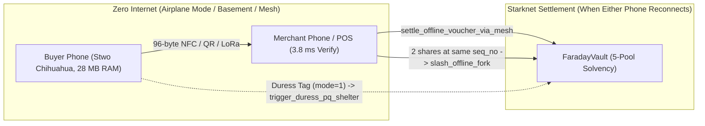

# Faraday

**Cash that works inside a Faraday cage.**

Every digital wallet stops working the moment your phone loses signal — in a subway, a basement bar, a packed conference hall, or a power outage. Worse, if someone forces you to unlock your phone on the street, one screen gives away your entire balance.

**Faraday** lets you tap two phones together to pay in USDC, BTC, or STRK with **zero cell service and zero Wi-Fi**, then settles automatically on Starknet as soon as either phone reconnects. Merchants are covered 100% against offline double-spends, and a second "panic" fingerprint opens a \$25 decoy wallet while quietly locking your real savings away.

---

## TL;DR

- **Problem:** Crypto wallets fail without internet and expose your full savings if you are forced to unlock your phone.
- **How it works:** Before going offline, you lock a spending note and an anti-fraud bond in [`FaradayVault`](src/vault.cairo). Offline, your phone proves each payment locally in **~73 ms** and sends a **96-byte** receipt over NFC, QR, or LoRa mesh.
- **Why merchants trust it:** If a buyer tries to spend the same offline balance twice, the two receipts leak the buyer's note secret on Starknet, slashing their bond to pay the merchant in full.

---

## Built on Stwo Chihuahua & Ethereum Foundation Cryptography

Faraday combines StarkWare's smallest Circle-STARK prover profile with cryptographic primitives pioneered by the Ethereum Foundation's **Privacy & Scaling Explorations (PSE)** group:

1. **Stwo Chihuahua (StarkWare):**
   Standard zero-knowledge provers are too heavy for mobile phones. Faraday's offline hop kernel ([`execute_faraday_offline_hop`](src/hop.cairo)) is built specifically for **Stwo Chihuahua** (`CanonicalSmall`, `PedersenPoints::<9>`, `log_size <= 20`), using only **4–5 Pedersen hashes**, **zero storage syscalls**, and **~28 MB of RAM**. The entire payment frame ([`FaradayPhoneNfcFrame`](src/hop.cairo)) fits in **96 bytes** — small enough for a single NFC tap, an optical QR scan, or one LoRa radio packet.
2. **Rate-Limiting Nullifiers / RLN (Ethereum Foundation PSE):**
   How do you stop double-spending when neither phone can check a blockchain? Faraday adapts **RLN** over the Starknet prime field $\mathbb{F}_P$. Every offline hop `(note_id, seq_no)` defines a unique secret line $y = s + a_1 \cdot x \pmod P$, where $a_1 = \text{pedersen}(\text{pedersen}(s, \text{note\_id}), \text{seq\_no})$. One honest payment reveals a single point $(x_1, y_1)$, keeping the secret key $s$ information-theoretically hidden. Spending the same `seq_no` twice to two merchants ($x_1 \neq x_2$) reveals two points on the same line. Any relayer can call [`recover_secret_from_offline_fork`](src/hop.cairo) to compute $s$, prove `pedersen(s, note_id) == root_commitment` inside [`slash_offline_fork`](src/vault.cairo), and reimburse the merchant from the cheater's bond.
3. **Anti-Coercion & Post-Quantum Safe-House (MACI-Inspired):**
   Inspired by Vitalik Buterin and EF PSE's **Minimal Anti-Collusion Infrastructure (MACI)**, Faraday binds hardware Secure Enclave / StrongBox biometric modes into disjoint tags (`mode = 0` for normal pay, `mode = 1` for duress). Entering a panic fingerprint or PIN triggers [`trigger_duress_pq_shelter`](src/vault.cairo): the attacker sees a normal \$25 transfer, while the remaining carrier balance is swept into a post-quantum recovery pool (`pq_recovery_pool`).

---

## Architecture



### Repository Layout

| Path | Purpose |
| :--- | :--- |
| [`src/hop.cairo`](src/hop.cairo) | Off-chain Stwo Chihuahua hop kernel, 96-byte NFC/LoRa header codec, and $\mathbb{F}_P$ RLN Shamir secret extractor |
| [`src/vault.cairo`](src/vault.cairo) | On-chain `FaradayVault` Starknet contract managing carrier notes, mesh settlement, RLN bond slashing, and duress shelter |
| [`src/proofs.cairo`](src/proofs.cairo) | Symbolic formal verification harnesses ($\mathbb{F}_P$ Shamir algebra, `u256` merchant coverage, EUF nullifiers, conservation) |
| [`src/tests.cairo`](src/tests.cairo) | End-to-end unit and Starknet contract tests (honest multi-hop, replay rejection, RLN slash, forged-proof rejection, duress sweep) |
| [`demo/index.html`](demo/index.html) | Self-contained interactive browser simulator (zero external CDN calls — works with Wi-Fi turned off) |
| [`scripts/verify.sh`](scripts/verify.sh) | One-command formatting, build, lint, test, audit, and formal verification script |

---

## Quickstart

### 1. Try the Offline Simulator

Open [`demo/index.html`](demo/index.html) directly in any browser (even in Airplane Mode):

```bash
open demo/index.html
```

### 2. Build with Scarb

Requires [Scarb](https://docs.swmansion.com/scarb/) `>= 2.18.0`:

```bash
scarb fmt --check
scarb build
```

### 3. Test, Audit, & Formally Verify with `uc`

With [Ultra Cairo (`uc`)](https://github.com/omarespejel/uc) installed:

```bash
uc lint
uc test
uc audit
uc prove --wide-domain
```

Or run the full pipeline in one step:

```bash
./scripts/verify.sh
```

---

## Formal Security Properties

[`FaradayVault`](src/vault.cairo) and [`src/proofs.cairo`](src/proofs.cairo) enforce and verify five core guarantees:

1. **Five-Pool Solvency Conservation (`invariant_five_pool_solvency_conservation`):**
   `total_vault_assets == active_carrier_pool + slash_bond_pool + merchant_claims_pool + pq_recovery_pool + relay_fee_pool` across minting, settlement, slashing, duress sweeps, and merchant withdrawals.
2. **Overflow-Free Offline Hop Conservation (`prove_faraday_offline_hop_conservation`):**
   `remaining_balance + spend_amount + relay_tip == prev_balance` across all `u128` balances.
3. **RLN Shamir Equivocation Soundness (`prove_shamir_offline_fork_algebra_in_fp`):**
   Over $\mathbb{F}_P$, $y_1 - y_2 \equiv a_1(x_1 - x_2) \pmod P$, guaranteeing secret recovery on $x_1 \neq x_2$ and zero false slashing when $x_1 = x_2$.
4. **Registered Note Binding on Slash (`slash_offline_fork`):**
   Slashing requires `pedersen(secret_key, note_id) == note_root_commitments[note_id]` and `!slashed_notes[note_id]`, preventing fabricated fork witnesses from draining the bond pool.
5. **Blinded Enclave Duress Authorization (`trigger_duress_pq_shelter`):**
   Sweeping carrier funds into `pq_recovery_pool` requires presenting the preimage `enclave_duress_tag` matching `note_duress_hashes[note_id]`.

---

## License

Licensed under the [Apache License, Version 2.0](LICENSE).
