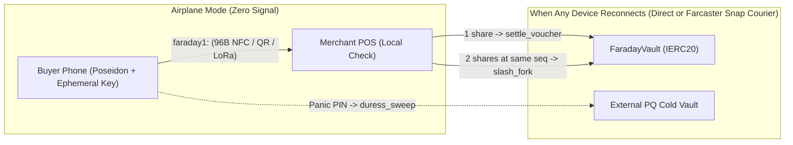

# Faraday

**Self-custodial cash that works inside a Faraday cage.**

Physical cash worked in a basement, on a subway, or during a blackout without asking a bank or a cell tower for permission. Digital wallets gave that up: lose signal and you cannot pay; get forced to unlock your phone on the street and one screen exposes your life savings.

**Faraday** brings bearer cash back to two phones over NFC, QR, or LoRa radio — backed by real ERC-20 collateral (`USDC`, `WBTC`, `STRK`) on Starknet. Honest taps are private and settle whenever either phone reconnects. Merchants are covered 100% against offline double-spends, and a panic fingerprint pays out a \$25 decoy while sweeping your real balance + bond straight into an external post-quantum cold vault.

---

## Why Faraday Exists

| Existing Rail | Where It Breaks | How Faraday Fixes It |
| :--- | :--- | :--- |
| **Apple Pay / Card Rails / CBDCs** | Dies without network access; logs your identity at every register. | Works with **zero internet**; uses ephemeral note keys with **zero identity link** when honest. |
| **Cashu NFC eCash** | Great offline UX, **100% custodial** — the mint operator holds all the money. | **100% self-custodial** inside [`FaradayVault`](src/vault.cairo) on Starknet. |
| **Full Browser/WASM Block Provers** *(e.g. `snip-36-prover-wasm`: 13.3 GiB RAM, 72 s, 231 KB proof)* | Too heavy and too large for a 100 ms phone NFC tap or 200-byte LoRa packet. | Runs a tiny **Poseidon + Stwo M31** pocket circuit (`<5 MB` RAM) offline and settles a compact signed voucher on-chain. |

---

## Three Cryptographic Primitives, Zero Bloat

1. **Poseidon + Stwo M31 Pocket Vouchers (StarkWare / `stwo-zig` / `cairo-m`):**
   Every commitment, nullifier, and challenge in [`src/protocol.cairo`](src/protocol.cairo) uses Starknet's native **Poseidon** sponge (`hades_permutation`) — **zero elliptic-curve hashes** in commitments, 4x cheaper on Starknet than Pedersen, post-quantum collision-resistant, and native to Mersenne-31 Circle-STARK provers (`starkware-libs/stwo`, `starknet-innovation/stwo-zig`, `kkrt-labs/cairo-m`).
2. **Deterministic Rate-Limiting Nullifiers / RLNv2 (Ethereum Foundation PSE + `vacp2p/zerokit`):**
   How do you stop double-spending when neither phone can check Starknet? Each offline hop `(note_id, seq_no)` defines a secret line over the Starknet prime field $\mathbb{F}_P$:
   - Slope: $a_1 = \text{Poseidon}(\text{Poseidon}(s, \text{note\_id}), \text{seq\_no})$
   - Deterministic checkout challenge: $x = \text{Poseidon}(\text{merchant}, \text{amount}, \text{nonce})$
   - Share: $y = s + a_1 \cdot x \pmod P$

   One honest payment reveals a single point $(x_1, y_1)$, keeping $s$ information-theoretically hidden. Paying two checkouts at the same `seq_no` forces $x_1 \neq x_2$, letting any relayer call [`recover_secret_from_fork`](src/protocol.cairo) to extract $s$ and reimburse every defrauded merchant via [`slash_fork`](src/vault.cairo).
3. **Coercion Teleport & Opt-In Citizen Bonds (MACI-Inspired + Network State Ready):**
   - **\$5-Wrench Shield:** Revealing `duress_secret` in [`duress_sweep`](src/vault.cairo) pays a small decoy (e.g. \$25) while sweeping **100% of remaining cash + bond** directly to your external post-quantum vault address (`pq_safe_recipient`, compatible with `starknet-innovation/qsb-app` / `krusty-kms` `pqb` or Falcon-512 AA accounts).
   - **Anonymous by default, accountable when opted in:** `citizen_tag` defaults to `0` (pure anonymous bearer cash). Pop-up cities and Network School campuses can optionally bond a blinded Farcaster / Network State `fid` commitment — invisible during honest taps, exposed **only** inside `OfflineForkSlashed` if RLN proves fraud.

---

## Architecture: One Struct, Six Functions

Instead of sprawling pool accounting, [`FaradayVault`](src/vault.cairo) isolates every user card into a single `OfflineNote` struct with six lifecycle entrypoints:



| Entrypoint | What It Does |
| :--- | :--- |
| `open_note` | Locks ERC-20 `deposit + bond` (`bond >= deposit`) with blinded `commitment`, `duress_hash`, and `pq_safe_recipient`. |
| `settle_voucher` | Verifies ephemeral Stark ECDSA signature + fresh `nullifier`; pays `merchant` and `relayer` directly in ERC-20. |
| `slash_fork` | Verifies two distinct RLNv2 points `(x1, y1), (x2, y2)` matching `note.commitment`; freezes note and reimburses defrauded merchants. |
| `duress_sweep` | Verifies `duress_secret`; pays `decoy_amount` and teleports all remaining `balance + bond` to `pq_safe_recipient`. |
| `request_close` | Starts the on-chain settlement grace window (e.g. 24h) so offline merchants can finish settling. |
| `finalize_close` | After the grace window clears with zero fraud, refunds 100% of unspent `balance + bond` in ERC-20 to `owner`. |

### Repository Map

- [`src/protocol.cairo`](src/protocol.cairo) — Pure Poseidon + RLNv2 voucher kernel, deterministic `challenge_x`, 96B header codec, and $\mathbb{F}_P$ secret extractor
- [`src/vault.cairo`](src/vault.cairo) — Self-custodial `IERC20` `FaradayVault` contract (CEI-ordered, per-note isolated)
- [`src/proofs.cairo`](src/proofs.cairo) — Symbolic formal verification suite ($\mathbb{F}_P$ Shamir algebra, `u256` collateral coverage, Poseidon EUF nullifiers)
- [`src/tests.cairo`](src/tests.cairo) — 10 end-to-end tests with `MockERC20`, real Stark-curve ECDSA signatures, multi-victim slashing, duress teleport, and grace-window refunds
- [`snap/`](snap/) — Optional **Farcaster / Network State Snap** (`@farcaster/snap` v2) courier relay & TypeScript $\mathbb{F}_P$ RLNv2 watchtower
- [`demo/index.html`](demo/index.html) — Zero-dependency offline browser simulator (works in Airplane Mode)

---

## Quickstart

```bash
# 1. Open the interactive simulator (works offline with Wi-Fi off)
open demo/index.html

# 2. Format & compile Cairo contracts (Scarb >= 2.18.0)
scarb fmt --check
scarb build

# 3. Run the Farcaster Snap F_P RLNv2 Watchtower tests (Node 22+)
node --experimental-strip-types snap/src/rln.test.ts

# 4. Run full lint, 10-test suite, audit, & symbolic proofs (with Ultra Cairo `uc`)
./scripts/verify.sh
```

---

## License

Licensed under the [Apache License, Version 2.0](LICENSE).
